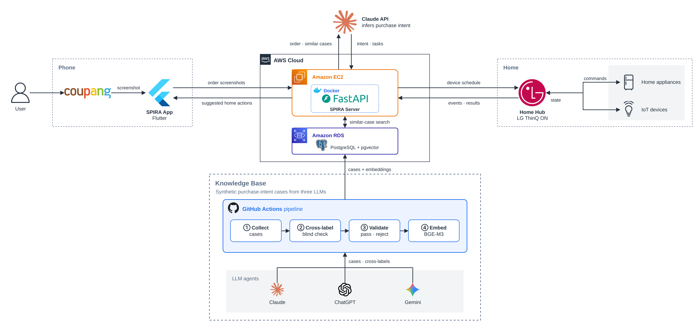

# 🏠 SPIRA

**Your order arrives. Your home is already prepared.**

> 26-2 Hanyang University · Software Engineering & AI and Applications Project

SPIRA reads an order screenshot, finds similar cases in a synthetic purchase-intent knowledge base, judges the purpose of the order, and prepares the home with appliances and IoT devices without asking.



## Repository map

| Folder | What | Owner |
| --- | --- | --- |
| [`app/`](app) | Flutter app: share orders, preparation card, stop / switch off | Yejoon Kim |
| [`server/`](server) | SPIRA Server: extract → retrieve → judge intent → tasks → plan (S1–S7) | Seojin Lee |
| [`hub/`](hub) | Home Hub: pull plan, triggers, execute, read back, restore | Yejoon Kim |
| [`simulator/`](simulator) | Virtual household (MQTT) + 3D house view | Yejoon Kim |
| [`demo-shell/`](demo-shell) | Presenter screen: phone, server steps and the house; shared design assets | Seojin Lee |
| [`contracts/`](contracts) | Values shared between parts: API, schemas, enums, fixtures | Shared |
| [`docs/`](docs) | Architecture ([text](docs/architecture.md) · [figure](docs/spira-architecture.png)) · Paper ([LaTeX](docs/paper.tex) · [PDF](docs/paper.pdf)) | Shared · Jeewon Lee |
| [SPIRA_KB](https://github.com/CSE-SPIRA/SPIRA_KB) | Synthetic purchase-intent knowledge base (separate repository) | Uijin Lee |

## Where to start

1. Read [`contracts/README.md`](contracts/README.md) — the values every part agrees on.
2. Read the `README.md` and `spec.md` in your part folder.
3. Follow [`.github/CONTRIBUTING.md`](.github/CONTRIBUTING.md) for branches and pull requests.

## Run the demo

One terminal from the repository root starts MQTT, the Server, the Simulator, the Hub and the demo shell:

```bash
server/scripts/demo_live.sh --fresh
```

Then open `http://127.0.0.1:8733/demo`. One-time setup is in [`server/README.md`](server/README.md#demo-with-the-hub-and-the-simulator-s6s7); the screen is described in [`demo-shell/README.md`](demo-shell/README.md).

## Paper

Build from `docs` with [Tectonic](https://tectonic-typesetting.github.io):

```bash
cd docs
tectonic -X compile paper.tex
```

## Team

| Name | Part |
| --- | --- |
| Jeewon Lee | Paper integration, deployment |
| Uijin Lee | Knowledge base |
| Seojin Lee | Server, integration contracts, evaluation |
| Yejoon Kim | App, Home Hub, Simulator |
