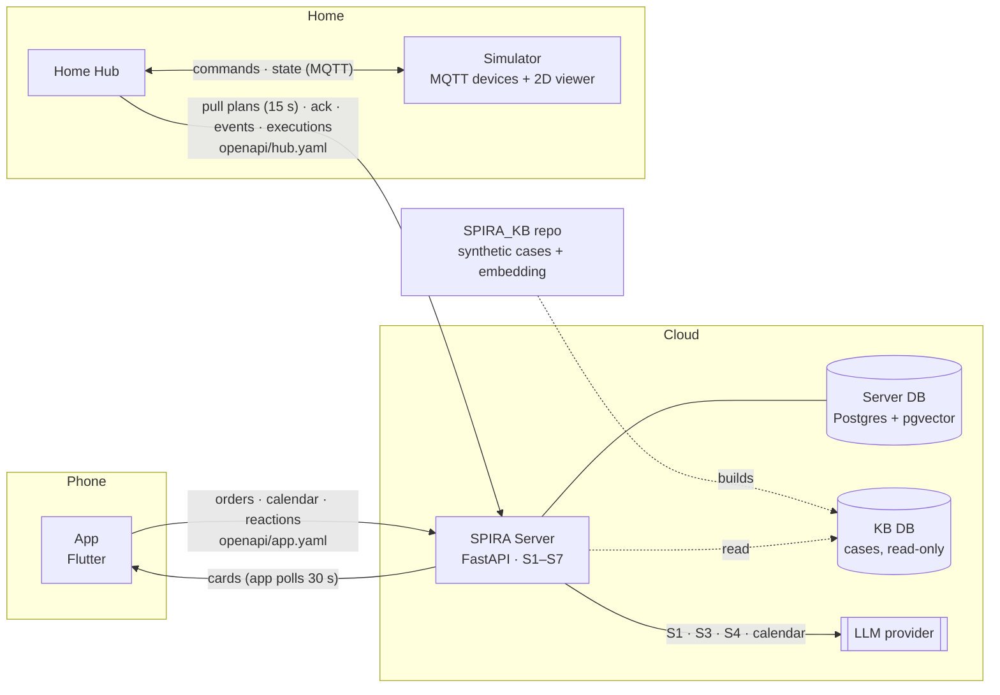

# SPIRA Architecture

How the parts fit together. Details live in each part's `spec.md` and in [`contracts/`](../contracts); this page only connects them.

## 1. Overview

- The **server never calls the hub or the app.** Both poll; the server only answers.
- The **LLM never runs a device and never makes a time.** It reads screenshots and judges intent; code builds the plan (`server/spec.md` §0).
- The home moves at two moments only: when the order arrives home (`package.brought_in`) and around a calendar event.

## 2. Repository layout

| Folder | What | Owner |
| --- | --- | --- |
| [`app/`](../app) | Share order screenshots, show the preparation card, stop / switch off lines | Yejoon |
| [`server/`](../server) | S1–S7 pipeline, App and Hub APIs | Seojin |
| [`hub/`](../hub) | Pull plan, wait for triggers, check state, execute, read back, restore | Yejoon |
| [`simulator/`](../simulator) | Virtual household devices (MQTT) and a 2D viewer; emits home events | Yejoon |
| [`contracts/`](../contracts) | Everything parts must agree on: API, schemas, enums, fixtures, generated models | Shared |
| [`docs/`](.) | This page · [`paper.tex`](paper.tex) · [`paper.pdf`](paper.pdf) (Jeewon) | Shared |
| [SPIRA_KB](https://github.com/CSE-SPIRA/SPIRA_KB) | Synthetic purchase-intent cases, lists, embedding function (separate repo) | Uijin |

Each part folder has `README.md` (how to run) and `spec.md` (what it does). Inside a part folder, the owner decides the layout.

## 3. One order, end to end

| # | Who | What | Contract |
| --- | --- | --- | --- |
| 1 | App → Server | Share 1–3 order screenshots (`POST /v1/orders`), returns 202 | `openapi/app.yaml` |
| 2 | Server S1 | After a quiet period, read items with the LLM; label, mask, merge | — |
| 3 | Server S2 | Order time, this home's history, KB neighbours, calendar tags | C-5 cases |
| 4 | Server S3 | Judge intent (LLM, one call) | — |
| 5 | Server S4 | Make tasks per device; times come from `find_time`, not the LLM | C-2 devices |
| 6 | Server S5 | Confirm a plan version and a card | C-1 plan, C-6 card |
| 7 | App | Poll cards; user may stop a line or switch the card off → new plan version | C-6, C-7 |
| 8 | Hub | Pull plan, ack, wait for trigger (`package.brought_in`, calendar time) | C-1, C-3 events |
| 9 | Hub ↔ Simulator | Check state, run commands, read back, restore | — |
| 10 | Hub → Server | Report events and execution results | C-3, C-4 |
| 11 | Server S5–S7 | Update line states; close the observation window; save this home's case | C-7, C-5 |

[`contracts/fixtures/ep_9031/timeline.md`](../contracts/fixtures/ep_9031/timeline.md) shows every payload of this flow for one birthday-party order.

## 4. Contracts first

A value that crosses a part boundary is defined once, in `contracts/`.

1. Agree it in the Notion *SPIRA integration contract*.
2. Open a PR that changes `contracts/` only; affected owners review.
3. CI (`contracts`, required) checks schemas, enums, fixtures and that `contracts/generated/` is up to date.
4. Each part picks up the regenerated models: Python `spira_contracts` (server, hub), Dart `spira_contracts.dart` (app).

All values are English codes; Korean appears only in display text.

## 5. Data

| Store | Holds | Who writes |
| --- | --- | --- |
| Server DB | Households, devices, calendar, episodes, tasks, plans, cards, events, executions, windows, this-home `cases` | Server |
| KB DB | Synthetic `cases` with embeddings, versioned (`kb-v1`, …) | KB build (Uijin); server reads only |
| Temp images | Order screenshots until read (≤ 1 day) | Server |

Calendar titles and raw screenshots are never kept. Connection URLs and keys live only in `.env` files.

## 6. Environments and switches

| | How |
| --- | --- |
| Local | `server/`: `docker compose up` (API + Postgres with pgvector). LLM `mock` for tests |
| Demo | `DEMO_MODE=1` shortens waiting times (`contracts/rules.md`) |
| Evaluation | `KB_MODE`, `HOME_CONTEXT`, `KB_SAMPLE` turn parts of the context off (`server/spec.md` §15) |

## 7. Read next

- [`contracts/README.md`](../contracts/README.md) → `rules.md` → your part's OpenAPI file
- [`server/spec.md`](../server/spec.md) · [`hub/spec.md`](../hub/spec.md) · [`app/spec.md`](../app/spec.md) · [`simulator/spec.md`](../simulator/spec.md)
- [`.github/CONTRIBUTING.md`](../.github/CONTRIBUTING.md) for branches and PRs
