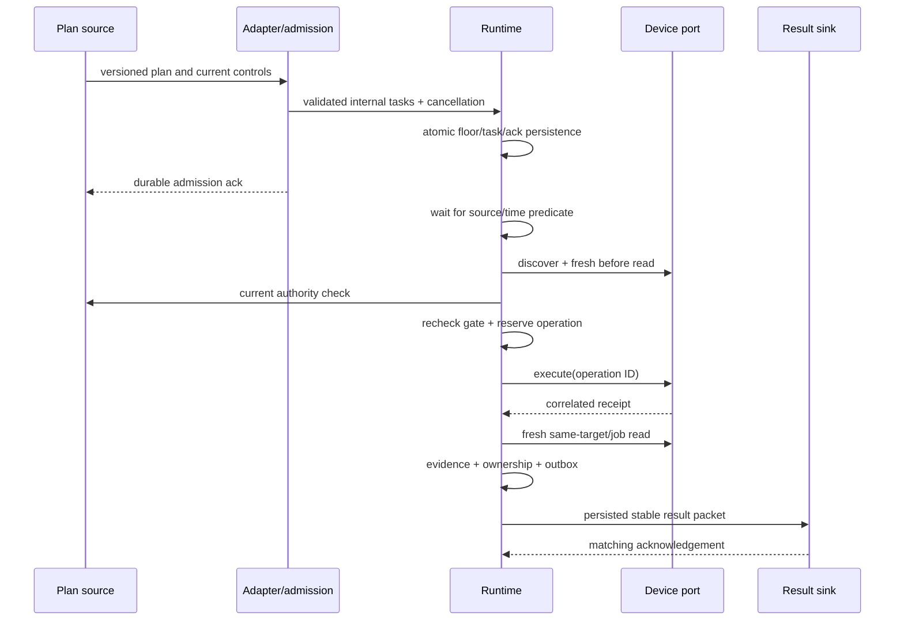

# Home Hub implementation specification

This document is the normative implementation specification for `hub/`.
`MUST`, `MUST NOT`, `SHOULD`, and `MAY` are normative. Shared HTTP bodies,
identifiers, enums, polling rules, and state meanings remain authoritative in
[`contracts/`](../contracts/README.md); this document defines Hub-owned state,
algorithms, recovery, and acceptance. If they conflict, the contract wins.

This specification does not certify a runtime, Server integration, or physical
device. Those claims require the corresponding implementation and evidence.

## 1. Purpose, scope and owners

Home MUST turn a versioned execution request into durable local work, wait for its
delegated trigger, check current authority, dispatch to the selected native target,
independently observe the outcome, report evidence, and conditionally restore only
still-owned temporary properties. It MUST NOT infer an order, purchase intent,
preparation, household preference or missing schedule. Server and KB remain
separate owners. An App card is not a Home task. Test peers MUST identify
themselves as test actors.

## 2. Glossary and domain objects

| Object | Identity / consequential content |
| --- | --- |
| Household / installation | Explicit household ID, installation revision, logical→native bindings; separate from credentials |
| Registry entry | Logical device ID/type, room, label, admitted flag, delegated commands/value schemas, never, events, noisy, binding epoch |
| Plan batch | `(plan_id, version)`, canonical envelope, admission result; current floor is per plan |
| Task / action | Episode, plan/version, semantic line and native action ID, family, native target, concrete desired values, trigger, validity, prechecks, end/restore |
| Trigger / end | Source-bound predicate plus occurrence time/window/delay; end MAY include alternatives, maximum duration or stable-state completion |
| Attempt | Durable operation ID, reservation/start time, before state, receipt, observation and outcome; never equivalent to command success |
| Observation | Native target, independent source time, availability, property values/revisions, substrate and USER/SPIRA/UNKNOWN provenance |
| Ownership | One `(native target, property)` claim: task, before value, desired value, post-effect revision and owned flag |
| Event / result | Stable event identity / persisted result sequence and packet; observations and claims remain separately attributable |
| Control | Plan Stop, task disable, household pause; distinct scope and semantics |

Native `Task.key` is a structured JSON encoding of plan ID/version/action ID,
never a delimiter-concatenation guess. Started action identity MAY continue across
plan versions through explicit durable carry metadata. A logical rebind MUST NOT
transfer a prior action's ownership to the replacement device.

## 3. Component and process boundary

```text
plan source -> boundary validation/conversion -> admission -> SQLite
                                                    -> scheduler
result sink <- stable outbox <- verification <- device port -> independent world
```

Home MUST use protocol I/O to devices/Simulator, MUST NOT import Simulator or App,
and MUST NOT use a Home state mirror as independent truth. Its process,
SQLite database, clock policy and lifetime MUST be independent of App. Multiple
workers on one DB are unsupported; one event-loop owner MUST serialize execution.
An integration harness MAY orchestrate multiple processes through public ports.

## 4. Architecture and responsibility map

| Target module owner | Responsibility and dependency rule |
| --- | --- |
| `api.py` / `bootstrap.py` | Lifespan, configuration, connector/Server composition, local auth/health; no intent logic |
| `domain.py` | Strict Task/Trigger/End/Capability/Observation/Receipt/Event; no wire imports |
| `runtime.py` | Floor/control gate, waits, reservation, verification, lifecycle, ownership and compaction |
| `clock.py` / `durations.py` | Wall/virtual time and explicit duration validation |
| `rules.py` | Pure source/order/window evaluation and next rule frontier |
| `store.py` | SQLite schema/additive migrations, transactions and atomic result publication |
| `registry.py` | Installation, logical binding, capability and delegation ownership |
| `connectors/` | Device port and native I/O/readback/conditional-write qualification |
| `server_adapter.py` | Generated-contract validation, normalization, admission transport and outgoing packet conversion |

Splits SHOULD occur only when they remove a real dependency conflict. The Hub
MUST have one canonical implementation tree; fixture, compatibility, or demo
packages MUST NOT become a second execution engine.

## 5. Platform, runtime and configuration

Python >=3.12, pinned Python dependencies, FastAPI/Uvicorn, SQLite WAL/FULL, an
HTTP client, and an MQTT client are the selected baseline. Configuration MUST be
resolved before admission:

| Profile | Required settings / constraint |
| --- | --- |
| Local no-device | Dedicated DB and no device connector; can admit an empty/no-effect batch without Server |
| Team Server | Server URL, household ID, Hub key reference, dedicated DB and installation/binding state; uses generated contract models |
| Isolated Simulator | Dedicated DB, MQTT namespace and matching isolated clock; never shares state with another scenario |
| Physical candidate | One named adapter/controller and qualification profile; never inferred from virtual success |

MQTT host/port/prefix and physical adapter endpoint/token/roles belong to their
adapters. Unknown profiles MUST fail startup. An installation MUST have separate
state and explicit household/binding revision fences. Service MUST
use HTTPS except a loopback fixture. Secrets MUST be resolved through a local
secret-store port or provisioned environment, never written in plans or evidence.
A missing secret reference MUST fail clearly without including its value.

## 6. Domain invariants and numbered requirements

<a id="h1"></a>

### H1. Household, registry and provisioning

**H1-R1.** Home MUST accept a one-time App provisioning handoff only through an
explicit local setup/secret-store port; local wire, authentication and rotation
remain an external joint decision. It MUST store the provisioned household/key in
local secret storage, never claim that an environment value implements pairing.
**H1-R2.** Discovery MUST yield candidates; Home MUST revalidate target existence
and capabilities before persisting an admitted logical→native binding.
**H1-R3.** Room/label edits MUST preserve logical identity and increment projection
revision. Device replacement MUST isolate past restore authority by native binding.

<a id="h2"></a>

### H2. Capability and standing delegation

**H2-R1.** The Server projection MUST include admitted devices only, intersect
actual verified capabilities with delegated commands/value ranges and hard `never`
prohibitions, and include room/type, events, noisy, substrate and revision.
**H2-R2.** Projection changes MUST increase revision and be republished; an unknown
device type MUST remain data when its capability schema is valid. Discovery or
order sharing MUST NOT grant delegation. ThinQ Connect SDK surface is not live
appliance qualification; connector availability and authority remain independent.

<a id="h3"></a>

### H3. Admission and version identity

**H3-R1.** The Server adapter MUST pull current Server plans, validate C-1 v3
headers and addressable lines, then convert to internal tasks. Admission MUST NOT
read current device state, availability, in-use or completed-today observations.
**H3-R2.** Invalid addressable lines MUST receive explicit task-level reasons while
valid siblings commit; malformed/unaddressable envelopes MUST reject atomically.
Capability, delegated command and value-schema checks are admission metadata checks.
**H3-R3.** A duplicate canonical body at the current version MUST reuse the saved
ack without creating work. A changed body at the same identity/version MUST fail
as a conflict. A lower version MUST be ignored without lowering the durable floor.
Plan floors, accepted tasks, ack,
carry and cancellation metadata MUST commit together before ack delivery.
**H3-R4.** Cancellation takes precedence, preserving its restore flag. A started
semantic action MUST retain its operation/action identity across versions; a
changed started action MUST be rejected. Unreleased item work MUST stay absent
from executable tasks until the plan source explicitly releases it.

<a id="h4"></a>

### H4. Triggers and events

**H4-R1.** Home MUST validate household/source/event ID, deduplicate durably and
match only delegated source-bound rules within validity/order/window bounds.
It MUST normalize known actors to user/spira and retain unknown as unknown.
**H4-R2.** Event-time predicates MUST use occurrence time; durable ingress cursors
MUST exclude pre-admission facts and distinguish same-time later ingress.
Package/guest/quiet-end rules MUST require supplied source bindings and schedules.
**H4-R3.** A first-event delay MUST bind to the first valid occurrence; fallback and
maximum duration MUST be explicit. Stable conditions MUST reset after a gap,
contradiction or process downtime. Relevant raw/derived events MUST enter a durable
outbox; Home MUST NOT infer purchase intent or release package plans itself.

<a id="h5"></a>

### H5. Current authority and dispatch

**H5-R1.** The plan source owns logical target and concrete values. Home MUST check
current plan/line/Stop/pause/delegation immediately before a new effect, after
awaited device reads and before reservation. Missing/unconfirmed/failed current
pull MUST defer new work while existing lifecycle/restore continues locally.
**H5-R2.** Home MUST recheck active binding, capability, online/fresh state,
parameters, before keys, busy/done/quiet/room constraints and conflicting property
ownership. It MUST NOT substitute a different logical device or infer a value.
**H5-R3.** A guarded atomic WAITING/RETRY_WAIT→EXECUTING reservation MUST persist
operation ID, before state, start time and event cursor before connector dispatch.
Concurrent eligibility readers MUST NOT reserve the same action twice.

<a id="h6"></a>

### H6. Receipt, fresh observation and jobs

**H6-R1.** Home MUST record receipt accepted/rejected separately from effects and
require its operation ID to match the reservation. Accepted MUST trigger fresh
readback of the same target; stale, missing-key, unavailable or contradictory
readback MUST NOT become VERIFIED. No reply MUST remain UNVERIFIABLE/INDETERMINATE.
**H6-R2.** RUN_JOB MUST distinguish accepted, independently observed running and
fresh same-job completed state. An adapter without stable run identity MUST retain
attribution uncertainty. Replacement/stopped foreign jobs MUST NOT be stopped by
an old task. A stop requires fresh run/job revisions and native conditional write.
**H6-R3.** Process death or dispatch uncertainty MUST NOT cause blind retry. Only a
proven no-effect failure MAY retry within its validity and bounded attempt policy.

<a id="h7"></a>

### H7. Ownership, intervention and restoration

**H7-R1.** After verified effect, Home MUST save before/desired values and property
revision witnesses only for changed temporary properties. It MUST observe later
revisions and relinquish ownership on independent change, including away-and-back
and change during verification. Desired final equality MUST NOT recreate authority.
**H7-R2.** On end/Stop/cancel with restore requested, Home MUST independently read
current state, reconcile ownership and conditionally restore only still-owned
properties using native revision protection. Missing CAS MUST skip as unsafe;
revision conflict MUST preserve the outside value. Unknown conflict MUST NOT be
labelled USER without independent provenance.
**H7-R3.** User-changed properties MUST be skipped; an oven cooking job started by
a person MUST NOT be stopped as cleanup of a prior preset. Rebinding MUST NOT
restore the old device's saved value to its replacement. A cancellation with
restore=false MUST relinquish authority and preserve the effect record.

<a id="h8"></a>

### H8. Evidence and delivery

**H8-R1.** Result publication MUST atomically persist task outcome plus outbox row.
Outgoing C-3/C-4 packets MUST be converted at the adapter, assigned stable
installation/event/result identities and persisted before HTTP. Retries MUST reuse
identical packet/ID; only a valid matching acknowledgement may mark delivered.
**H8-R2.** Evidence MUST distinguish attempted, receipt, observed/verified state,
actual binding, substrate, actor, failure/unknown and restore result. Partial
multi-action truth MUST remain partial. Home MUST NOT conclude that a user liked
an effect or turn silence into permission/preference.

<a id="h9"></a>

### H9. Restart and reconciliation

**H9-R1.** Startup MUST load future work, floors, attempts, ownership and outboxes;
reconcile current version/Stop/pause/cancel before new dispatch; reset unwitnessed
stability intervals. A reserved unresolved dispatch MUST become INDETERMINATE and
MUST NOT execute again. Interrupted restore MUST retain uncertainty.
**H9-R2.** Retry of unacknowledged event/result packets MUST preserve their durable
identity. Home MUST re-read independent state before resuming restore; old binding
ownership MUST never migrate to a replacement target. Reconnect is not a reset.

## 7. Persistence, indexes, retention and migrations

SQLite ownership MUST be one local writer, WAL and synchronous FULL. Target schema:

| Table / primary identity | Required retained contents |
| --- | --- |
| `plans(id)` | Highest version, retained even when tasks expire |
| `plan_batches(id,version)` | Canonical admitted envelope and receive time |
| `tasks(id)` | Strict internal body, status/result, before/after state, restore state, attempts/deadlines/start/end/stability/trigger timestamps, gate evidence, receipt, operation ID, admission/start event floors |
| `events(id)` | Raw source-bound event and ingress time |
| `controls(id)` | Pause, plan Stop and task disable values |
| `ownership(target,property)` | Task, before/desired/revision, owned |
| `outbox(seq)` | Immutable result record and delivery standing |
| `event_outbox(seq)` | Unique event ID, body, delivery standing |
| `bridge_state(id)` | Profile/household/installation fences, stable hub ID, ack/carry/cancel metadata, immutable outgoing packets |

The primary/unique keys above are mandatory indexes; scanning task JSON is the
current bounded implementation. Large-household scaling SHOULD add reviewed
status/end/target indexes without changing identity. Migrations MUST be additive,
transactional with backfills and tested on a populated old schema. DDL and event
cursor backfill MUST roll back together. A future destructive migration MUST have
backup, schema version, rollback and explicit ownership transition.
Acknowledged event/result history MAY compact after 14 days; active rule history,
undelivered truth, task identities and version floors MUST remain protected.
Local secret references MUST NOT store secret values in SQLite. Data retention
of plans/identities requires a separate explicit lifecycle decision; no automatic
identity purge is authorized here.

## 8. State machines and guards

```text
batch: received -> header rejected | line validation -> atomic admitted(partial?)
       same canonical version -> saved ack; stale/conflicting version -> conflict
work:  WAITING -> RETRY_WAIT -> WAITING/EXECUTING
       WAITING -> CANCELLED/SUPERSEDED/EXPIRED/PROHIBITED/UNSUPPORTED/ABSTAINED
       EXECUTING -> VERIFIED | RUNNING | MISMATCH | UNVERIFIABLE | INDETERMINATE
job:   RUNNING -> COMPLETED | OVERRIDDEN | STOPPED | UNVERIFIABLE
end:   active -> end predicate/cancel -> restore/stop reconciliation -> ended_at
restore: pending -> RESTORING -> RESTORED | skipped override/unsafe | failed | unknown
```

No receipt alone can traverse to VERIFIED/COMPLETED. Household pause cancels
resident unstarted work; resume MUST NOT revive that admitted version. New current
work requires a new authorized version. Local line off/on and Stop are not one
state: re-enable is only meaningful for unstarted work per plan-source semantics.
A restore failure before I/O MAY retry; uncertainty after reservation MUST remain
indeterminate. Terminal effect status and lifecycle closure MUST remain distinct.

## 9. Primary workflows



Stop/pause controls MUST persist before a later eligibility check. After dispatch,
controls cannot erase actual outcome. End processing MUST preserve that outcome,
reconcile per-property ownership, reserve restore and check native CAS/readback.

## 10. Failure, retries, timeouts and idempotency

Pre-dispatch unavailable/busy failures MAY retry only while deadline and attempt
budget allow; bounded exponential delay is `min(60, base*2^(attempt-1))` seconds,
maximum 10 configured attempts, default one. Accepted mismatch MUST NOT retry.
Current-authority failure defers with explicit blocked evidence, default 1 second.
HTTP timeout is 5 seconds; adapter retry MUST be bounded (current max 10 seconds).
Contract periodic pull is 15 seconds with an additional immediate pre-dispatch pull;
per-plan floors MUST NOT be misused as a household global cursor. Device verification
uses a configured finite monotonic timeout, sampling at 100ms; source times still
determine freshness. Restore pre-dispatch unavailability retries at 5 seconds.
Schema rejection MUST be retained visibly rather than silently delivered. Repeated
same identity with different content MUST fail at both plan and device boundaries.

## 11. Concurrency, transaction and locking order

One process/event loop MUST own Store. The runtime async lock encloses tick,
execution/lifecycle and restore; the plan-pull lock serializes HTTP snapshots.
If both are needed the order is runtime lock then pull lock. Pull MUST NOT await
runtime tick while holding its pull lock. SQLite transactions MUST contain only
local work: never hold a transaction across awaited HTTP/device I/O. Synchronous
ingress MAY change floors/controls while a read awaits, hence the final gate is
mandatory. Guarded SQL reservation is the final dispatch arbiter. Observation
callbacks MUST persist independently and revoke ownership while verification waits.
A new worker/threads model requires explicit locking/transaction redesign.

## 12. Recovery algorithm

```text
open/migrate DB; validate profile + household + installation fence
load floors/tasks/controls/ownership/outboxes
EXECUTING -> INDETERMINATE; RESTORING -> INDETERMINATE
clear trigger/stability continuity without a sensor witness
compose clock/device/plan-source/result-sink/secret-store ports
pull current snapshot (failure blocks only new dispatch)
resume waits; read independent state for lifecycle/restore
retry saved outgoing packets with the same identities
```

The dispatch-after-I/O crash window cannot promise exactly-once physical effects.
Durable reservation promises no blind duplicate dispatch by Home, with explicit
uncertainty. Operator reconciliation MAY inspect independent device state; it MUST
NOT turn guessed state into verified history or delete a floor to retry.

## 13. Security, privacy and secrets

All APIs SHOULD bind loopback/private interfaces; configured HOME_TOKEN MUST guard
control/state/results while health exposes no secrets. Provisioning and selected
Server credentials MUST use separate secret-store references; compare tokens in
constant time. Installation/profile edits MUST not bypass household/binding fences.
Logs/evidence MUST omit tokens, raw orders, fabric keys and full DB/bundles.
Fault APIs MUST remain isolated virtual-only; no automatic device reboot belongs
to normal search. Shared contract values and frozen source captures MUST NOT be
edited to satisfy local checks.

## 14. Observability, health and bounded evidence

Health MUST identify role, process liveness, timestamp and virtual mode. Liveness
MUST NOT imply Server/device readiness. Tasks/results/events/timeline and fresh
states SHOULD expose reason, source, cursor and unknown states. Outbox backlog,
last current-pull error and rejected packets MUST be diagnosable. Evidence receipts
MUST record code revision, commands, isolated process identities, bounds and gaps.
Transport/protocol software PASS MUST NOT imply native or physical qualification.

## 15. Ports, adapters and conversion ownership

| Port | Required semantics |
| --- | --- |
| Plan source | Deliver versioned requests and fresh controls; own ack delivery; no world reads during admission |
| Device (`Connector`) | Discover Capability, read Observation, execute with operation ID and optional revisions, stream Event, close |
| Result sink | Accept persisted result/event IDs, acknowledge or retain; no result reconstruction on retry |
| Secret store | Resolve configured references at composition; no provisioning wire invention |
| Clock | Wall clock or isolated independent virtual clock; monotonic timers for I/O bounds |

The Server adapter owns all C-1/C-2/C-3/C-4/HUB-15/16 DTO conversions.
Internal models MUST NOT import it. Local HTTP ingestion and fixture adapters are
replaceable development ports, not team authority. Generated internal schema is
not a shared team contract. App↔Hub provisioning and Hub↔device transport remain
explicit joint boundaries. MQTT or physical-controller qualification is
adapter-specific.

## 16. Recommended dependency layout

Use the owners in §4; composition/settings and narrow plan-source/result-sink/
secret-store contracts MAY be extracted beside them when tested. Dependency order:
`api/composition -> adapters -> internal model/runtime -> storage/rules`; native
connectors consume internal evidence types, never wire DTOs. Simulator is across
a transport, not a Python dependency.

## 17. Consequential algorithms

```text
admit(envelope):
  validate profile, household, revision, addressable IDs
  if same version: compare canonical body; return saved ack or conflict
  if below durable floor: conflict
  validate every line against declared binding/capability/schema (no device read)
  cancel entries take precedence; preserve restore choice
  reject changed started actions; carry unchanged started identity
  transaction: floor + batch + valid tasks + carry + cancellation + ack
  deliver saved ack

execute(task):
  await discover/read/prechecks
  await current-authority snapshot
  recheck durable floor/control/binding gate
  transaction: guarded reserve unique operation + before + ingress cursor
  await execute; persist correlated receipt
  await fresh same-target observation; for job require same operation/job identity
  reconcile all post-reservation property observations/revisions
  transaction: verified ownership only for changed still-authorized properties
  atomic result + outbox; no blind retry after uncertainty

restore(task):
  await fresh independent read; revoke changed ownership
  if no owned properties: skipped; if no native CAS: unsafe skipped
  persist RESTORING; await conditional write(expected per-property revisions)
  correlate receipt; await fresh readback; record outcome + outbox
```

## 18. Acceptance catalogue

Each row defines a required observable exit. A test location or passing status is
added only by the implementation PR that supplies the evidence.

| ID / initial state | Input | Required observation and exit |
| --- | --- | --- |
| HUB-AT01 empty dedicated DB, no devices/Server | Empty plan v1; restart; duplicate, changed same-version, then stale versions | Same ack for duplicate; changed same-version conflicts; stale version is ignored; floor never regresses; zero connector calls |
| HUB-AT02 installation plus valid/invalid sibling lines, offline world | Contract-valid plan envelope | Valid sibling admitted, invalid reason retained, zero device reads |
| HUB-AT03 admitted started line | Unchanged v2 then changed started action | Same operation and one dispatch for unchanged action; changed started action rejected |
| HUB-AT04 waiting delegated source predicate | Old fact then same-time later ingress, delay/window boundary | Only eligible source/time activates once |
| HUB-AT05 precheck read suspended | Stop/new floor/delegation revocation before reservation | Final synchronous gate observes revocation; zero new commands |
| HUB-AT06 accepted command | Wrong receipt ID/target or stale/missing-key readback | No verified/completed outcome; uncertainty remains explicit |
| HUB-AT07 running same job | Stale completion, then fresh completion; foreign replacement | Only fresh same-job completion closes; foreign job is preserved |
| HUB-AT08 verified temporary two-property effect | External change including away-and-back; end with conditional-write race | Changed/conflicting property preserved; protected remainder restored |
| HUB-AT09 started action and persisted packets | Process death/outage; reconnect | Unknown dispatch not repeated; identical packet ID/body resent |
| HUB-AT10 populated old task schema | Open/migrate twice; fail each backfill transaction | Identities retained; cursor backfill atomic and conservative; rerun idempotent |
| HUB-AT11 acknowledged old history plus pending/active rules | Compact after retention | Undelivered truth, active history, identities and floors remain |
| HUB-AT12 admitted waiting work | Pause then resume; cancellation restore true/false | No cancelled-version revival; restore choice remains durable |
| HUB-AT13 bounded Server peer plus independent world | Plan, event, readback, end and restart | Separate processes/state; App-facing projection reflects fresh observed truth; no real-Server claim |
| HUB-AT14 missing secret reference | Boot team-Server configuration | Fail before admission/effect; no secret value disclosed; pairing remains external |

## 19. Extensions and unsupported behavior

Connectors MAY add device families only with declared capability, correlated
receipts, fresh observation and explicit qualification. No native CAS means no
safe automatic restore claim. Arbitrary natural-language plans, purchase intent,
KB, multi-node consensus, blind job retry, rebind migration and production mobile
provisioning are unsupported until separately specified/adopted. No full-device
reboot, deployment, team promotion or contract redefinition follows from this spec.
